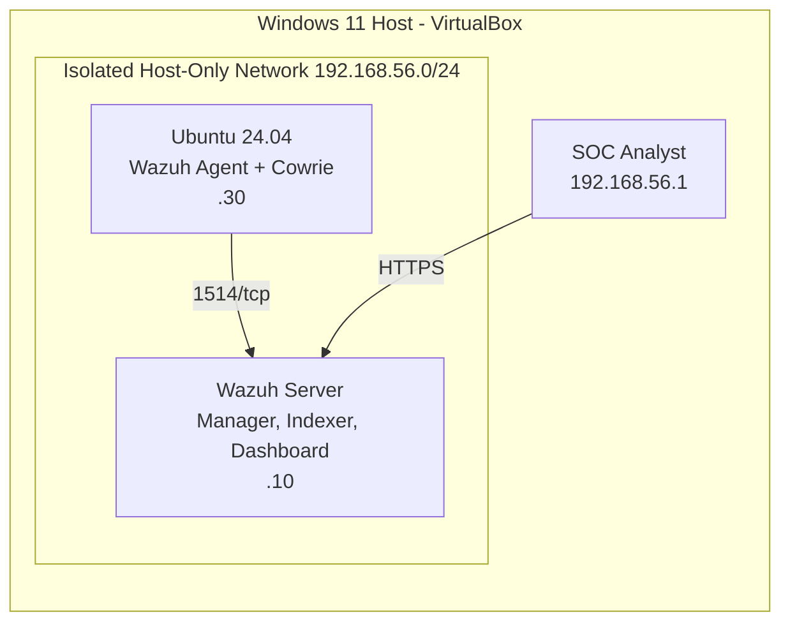

# Mini SOC - Security Operations Center Lab

A home Security Operations Center lab built with **Wazuh** and the **Cowrie** SSH honeypot. A Linux endpoint is monitored by a Wazuh agent, attacks are simulated inside an isolated network, and custom detection rules mapped to MITRE ATT&CK raise alerts in the Wazuh dashboard. Every detection has an incident response playbook.


## Highlights

- 2-VM lab on an isolated host-only network with no internet or home LAN access
- Centralized collection of Linux authentication logs, file integrity monitoring (FIM), and honeypot logs
- **13 custom detection rules** across 4 attack categories, mapped to MITRE ATT&CK
- Attack simulations used to validate the rules end to end, with dashboard evidence
- 4 incident response playbooks following the NIST SP 800-61 lifecycle
- Optional Windows extension (rules, scripts, playbook) provided separately and not validated in this lab

## Architecture



Full details: [docs/architecture.md](docs/architecture.md)

| Component | Role |
|---|---|
| Wazuh 4.14 (all-in-one) | SIEM: log analysis, correlation, alerting, dashboard |
| Wazuh agent | Collects auth logs, FIM events, and the Cowrie JSON log |
| Wazuh FIM (syscheck) | Real-time integrity monitoring of sensitive data and sudoers |
| Cowrie 3.1 | Medium-interaction SSH honeypot with JSON logging |

## Detection Rules

| Rule ID | Name | MITRE | Level | Validation |
|---|---|---|---|---|
| 100100 | SSH brute force against valid accounts | T1110.001 | 10 | Live alert |
| 100101 | SSH brute force with non-existent users | T1110.003 | 10 | Not yet tested |
| 100310 | Linux account added to sudo/admin/wheel | T1098 | 12 | Not yet tested |
| 100311 | New Linux user account | T1136.001 | 10 | Live alert |
| 100400 | Sensitive file changed, added, or deleted | T1565.001 | 12 | Live alert |
| 100401 | Sudoers configuration changed | T1548.003 | 12 | Not yet tested |
| 100500 | Cowrie event (base rule) | - | 3 | Live alert |
| 100501 | Honeypot connection | T1046 | 5 | Live alert |
| 100502 | Honeypot login failure | T1110 | 6 | Live alert |
| 100503 | Honeypot brute force | T1110.001 | 10 | Unit test (logtest) |
| 100504 | Honeypot login success | T1078 | 12 | Live alert |
| 100505 | Attacker command on honeypot | T1059.004 | 12 | Live alert |
| 100506 | Attacker file download on honeypot | T1105 | 14 | Not yet tested |

Rule sources: [wazuh/rules](wazuh/rules)

## Detection Results

| Simulated attack | Rule fired | Screenshot |
|---|---|---|
| Repeated failed SSH logins | 100100 | [view](screenshots/02-ssh-bruteforce.png) |
| New Linux user created | 100311 | [view](screenshots/07-new-admin-linux.png) |
| Sensitive file tampering | 100400 | [view](screenshots/08-fim.png) |
| Honeypot session with commands | 100501-100505 | [view](screenshots/09-honeypot-session.png) |

Procedures and the full test matrix: [docs/attack-simulations.md](docs/attack-simulations.md)

## Incident Response Playbooks

| Playbook | Covers |
|---|---|
| [PB-01 Brute Force](playbooks/PB-01-brute-force.md) | 100100, 100101 |
| [PB-03 New Admin Account](playbooks/PB-03-new-admin-account.md) | 100310, 100311, 100401 |
| [PB-04 File Integrity Violation](playbooks/PB-04-file-integrity-violation.md) | 100400, 100401 |
| [PB-05 Honeypot Activity](playbooks/PB-05-honeypot-activity.md) | 100501-100506 |

Each playbook follows the NIST SP 800-61 lifecycle: triage, containment, eradication, recovery, and lessons learned, with an evidence checklist.

## Quick Start

On the Wazuh server:

```bash
sudo bash scripts/server/install-wazuh.sh
sudo bash scripts/server/deploy-detections.sh
```

On the Linux endpoint:

```bash
sudo bash scripts/linux/install-agent.sh 192.168.56.10
sudo bash scripts/linux/install-cowrie.sh
```

Step-by-step guide: [docs/lab-setup.md](docs/lab-setup.md)

## Repository Structure

```
mini-soc-lab/
├── docs/                Architecture, setup, simulations, dashboard guide
├── extensions/windows/  Optional Windows rules, scripts, and playbook (not validated)
├── playbooks/           Incident response playbooks
├── screenshots/         Detection evidence
├── scripts/
│   ├── server/          Wazuh install and detection deployment
│   └── linux/           Linux agent and Cowrie honeypot
├── simulations/         Safe attack simulation script
├── tests/               wazuh-logtest rule unit tests
└── wazuh/
    ├── rules/           Custom detection rules
    └── shared/linux/    Centralized agent group configuration
```

## Skills Demonstrated

- SIEM deployment and administration (Wazuh manager, indexer, dashboard)
- Detection engineering: custom rules, correlation, frequency thresholds, MITRE ATT&CK mapping
- File integrity monitoring and Linux authentication log analysis
- Deception technology and honeypot log integration
- Adversary emulation in a controlled environment
- Incident response planning based on NIST SP 800-61

## Safety and Ethics

All attack simulations were performed only against virtual machines I own, inside an isolated host-only network with no route to the internet or my home network. No honeypot in this lab is exposed to the internet. An internet-facing honeypot must run on a separate, hardened cloud server with no other workloads.

## Future Work

- Validate the remaining rules (100101, 100310, 100401, 100506)
- Windows endpoint with Sysmon, using the files in `extensions/windows`
- Wazuh active response to block brute-force sources automatically
- Threat intelligence enrichment with CDB lists built from honeypot IOCs
- Alert forwarding to a case management platform
