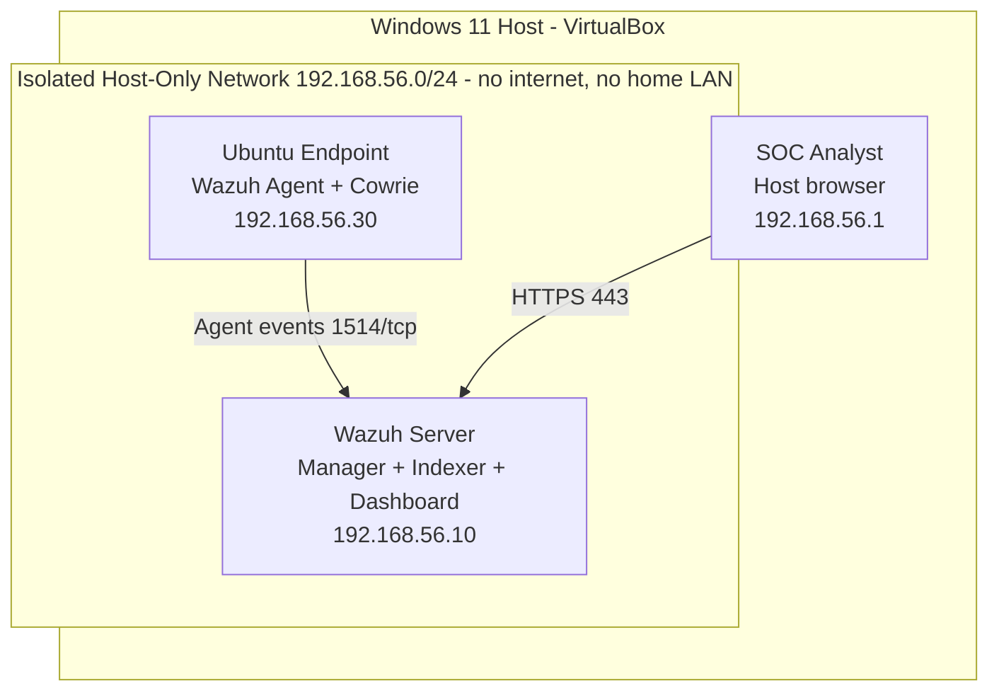
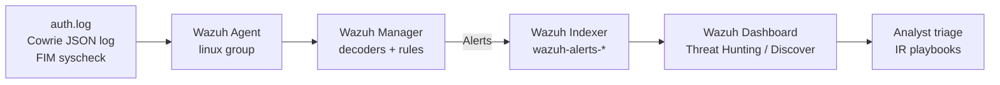

# Lab Architecture

## Network Diagram

## Data Flow

## IP Plan

| Host | Role | IP | OS |
|---|---|---|---|
| wazuh-server | SIEM (manager, indexer, dashboard) | 192.168.56.10 | Ubuntu Server |
| linux-endpoint | Monitored endpoint + SSH honeypot | 192.168.56.30 | Ubuntu Server |

## Ports

| Port | Service | Direction |
|---|---|---|
| 443/tcp | Wazuh dashboard | Analyst to server |
| 1514/tcp | Agent event forwarding | Agent to server |
| 1515/tcp | Agent enrollment | Agent to server |
| 55000/tcp | Wazuh API | Server internal |
| 22/tcp | Real SSH | Administration |
| 2222/tcp | Cowrie honeypot | Attacker to linux-endpoint |

## Attack Simulation

Attacks are generated on the linux-endpoint itself against `127.0.0.1` (failed SSH logins with `sshpass`, an interactive honeypot session on port 2222, account creation, and file tampering). Source IP in the alerts is therefore `127.0.0.1`.

## Isolation Controls

- Both VMs use a VirtualBox host-only adapter with its DHCP server disabled.
- A second NAT adapter is attached only during installation and disconnected afterwards.
- No port forwarding is configured from the host or home router to any lab VM.
- The honeypot runs inside the isolated network only. Any internet-facing honeypot must run on a dedicated, hardened cloud server with no other workloads.
